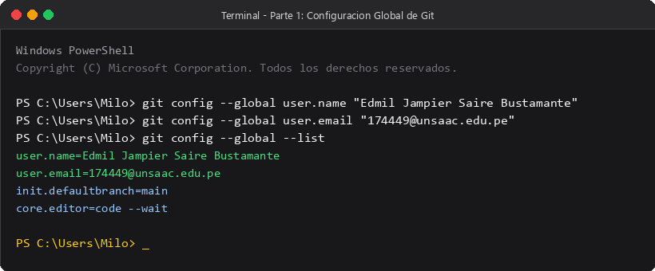
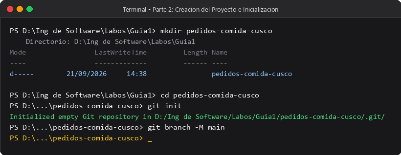
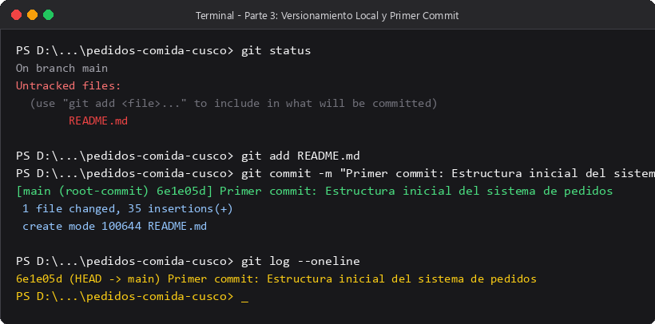
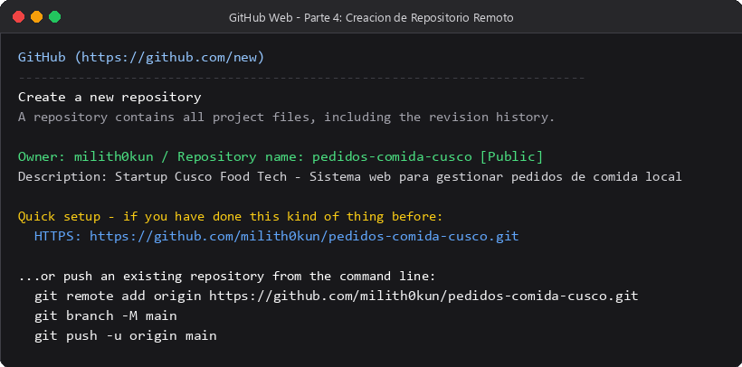
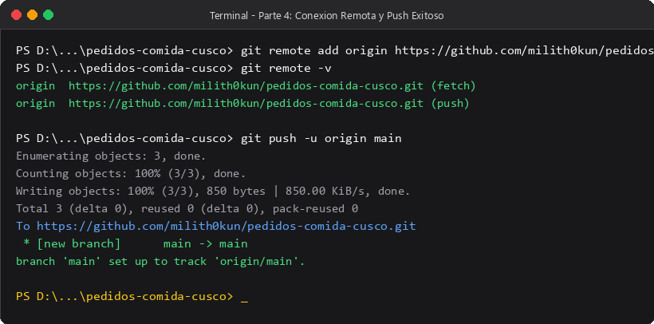
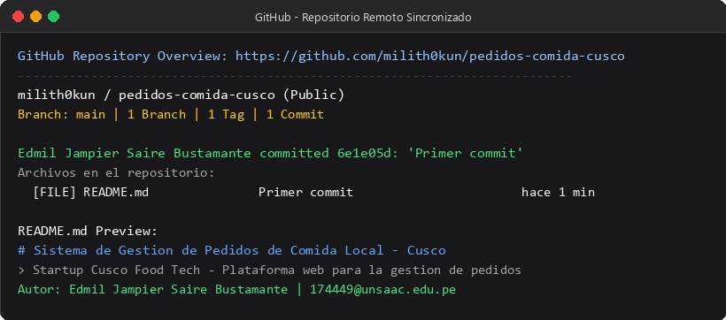

# INFORME DE LABORATORIO N° 1
## Introducción al Entorno de Desarrollo y Git

---

### Datos del Estudiante
* **Universidad:** Universidad Nacional de San Antonio Abad del Cusco (UNSAAC)
* **Carrera:** Ingeniería Informática y de Sistemas
* **Curso:** Ingeniería de Software
* **Docente:** Ing. Lisha Sabah Diaz Caceres
* **Alumno:** Edmil Jampier Saire Bustamante
* **Código:** 174449
* **Correo:** [174449@unsaac.edu.pe](mailto:174449@unsaac.edu.pe)
* **Repositorio en GitHub:** [https://github.com/milith0kun/pedidos-comida-cusco](https://github.com/milith0kun/pedidos-comida-cusco)

---

## 1. Objetivo
Configurar el entorno de desarrollo local con Git y aplicar control de versiones creando un proyecto básico, vinculándolo con un repositorio remoto en GitHub.

## 2. Resultados de Aprendizaje
* Entender la importancia del control de versiones en el desarrollo de software.
* Configurar Git con mis datos de usuario en la terminal.
* Manejar repositorios tanto en local (`init`, `add`, `commit`) como en remoto (`remote`, `push`).

## 3. Fundamento Teórico
Git es un sistema de control de versiones distribuido. Esto significa que cada desarrollador tiene una copia completa del historial en su propia máquina, permitiendo trabajar sin depender de conexión a internet.

Git trabaja con tres áreas principales:
1. **Directorio de trabajo (Working Directory):** La carpeta con los archivos en los que estamos trabajando.
2. **Área de preparación (Staging Area):** La zona donde seleccionamos qué cambios formarán parte del siguiente commit con `git add`.
3. **Repositorio local (.git):** Donde se guardan las versiones confirmadas de forma permanente mediante `git commit`.

## 4. Herramientas Utilizadas
* **Git:** Para el control de versiones en consola.
* **GitHub:** Para almacenar el repositorio en la nube y compartir el código.
* **Visual Studio Code:** Editor para redactar la documentación.
* **Windows PowerShell:** Terminal para ejecutar los comandos.

## 5. Caso Práctico
Para este laboratorio se tomó el caso de una startup en Cusco que necesita un sistema web para gestionar pedidos de comida típica (como Chiri Uchu, Lechón Cusqueño, Cuy Chactado y Kapchi). La meta de este laboratorio es dejar la estructura del proyecto organizada y bajo control de versiones desde el primer día.

---

## 6. Desarrollo de las Actividades

### Parte 1: Configuración de Git
Lo primero que hice fue configurar mi nombre y correo institucional en Git para que mis commits queden identificados con mi autoría.

Comandos ejecutados:
```bash
git config --global user.name "Edmil Jampier Saire Bustamante"
git config --global user.email "174449@unsaac.edu.pe"
git config --global --list
```

**Evidencia de configuración:**


---

### Parte 2: Creación del Proyecto e Inicialización
Creé la carpeta `pedidos-comida-cusco`, entré a ella e inicié el repositorio con `git init`. También me aseguré de que la rama principal se llame `main`.

Comandos ejecutados:
```bash
mkdir pedidos-comida-cusco
cd pedidos-comida-cusco
git init
git branch -M main
```

**Evidencia de inicialización:**


---

### Parte 3: Versionamiento Local
Creé el archivo `README.md` con la descripción del sistema de pedidos y los platos típicos. Revisé el estado con `git status`, añadí el archivo al área de preparación con `git add .` e hice mi primer commit.

Comandos ejecutados:
```bash
git status
git add README.md
git commit -m "Primer commit: Estructura inicial del sistema de pedidos"
git log --oneline
```

**Evidencia del commit:**


---

### Parte 4: Repositorio Remoto en GitHub
Ingresé a mi cuenta de GitHub (`milith0kun`), creé el repositorio público `pedidos-comida-cusco`, vinculé el origen remoto a mi máquina local y subí los cambios con `git push`.

Comandos ejecutados:
```bash
git remote add origin https://github.com/milith0kun/pedidos-comida-cusco.git
git remote -v
git push -u origin main
```

**Evidencia de creación en GitHub:**


**Evidencia del push:**


**Evidencia final en el navegador:**


---

## 7. Entregables

1. **Enlace del Repositorio:**  
   [https://github.com/milith0kun/pedidos-comida-cusco](https://github.com/milith0kun/pedidos-comida-cusco)

2. **Historial de Commits:**
   * `6e1e05d` - *Primer commit: Estructura inicial del sistema de pedidos*
   * *Docs: Mejorar documentación del README*

3. **README Documentado:**  
   El repositorio cuenta con su `README.md` detallando la propuesta de la startup, la lista de platos considerados, la forma de clonar el proyecto y mis datos de estudiante.

---

## 8. Reflexión

### ¿Por qué Git es crítico en proyectos colaborativos?
Cuando se trabaja en equipo (por ejemplo, en proyectos de la universidad o en una empresa), compartir archivos por Drive, ZIP o WhatsApp causa desorden rápidamente. Git es fundamental porque:
* Permite que varios integrantes trabajemos en el mismo proyecto al mismo tiempo sin pisarnos el código.
* Cada miembro puede crear su propia rama para programar una función y luego unirla a la rama principal cuando esté probada.
* Deja un registro claro de qué cambió cada persona, en qué fecha y con qué motivo.

### ¿Qué problemas evita?
1. **Sobreescritura accidental:** Evita que un compañero reemplace por error el trabajo que otro hizo la noche anterior.
2. **Pérdida de avances:** Si una actualización rompe el programa, con Git podemos regresar fácilmente al commit anterior donde todo funcionaba.
3. **El desorden de versiones:** Elimina tener carpetas como `proyecto_final`, `proyecto_final_v2`, `este_si_final.zip`. Todo el historial queda ordenado en una sola carpeta limpia.
4. **Falta de claridad en la autoría:** Ayuda a saber quién escribió cada fragmento de código ante cualquier consulta o error.

---

## 9. Conclusiones
* Logré configurar mi entorno de trabajo local y conectar mi cuenta de GitHub con la terminal sin inconvenientes.
* Se entendió claramente la diferencia entre el directorio de trabajo, el área de preparación y el repositorio local.
* El caso práctico de la startup cusqueña quedó estructurado y respaldado en la nube con su respectivo enlace público.
