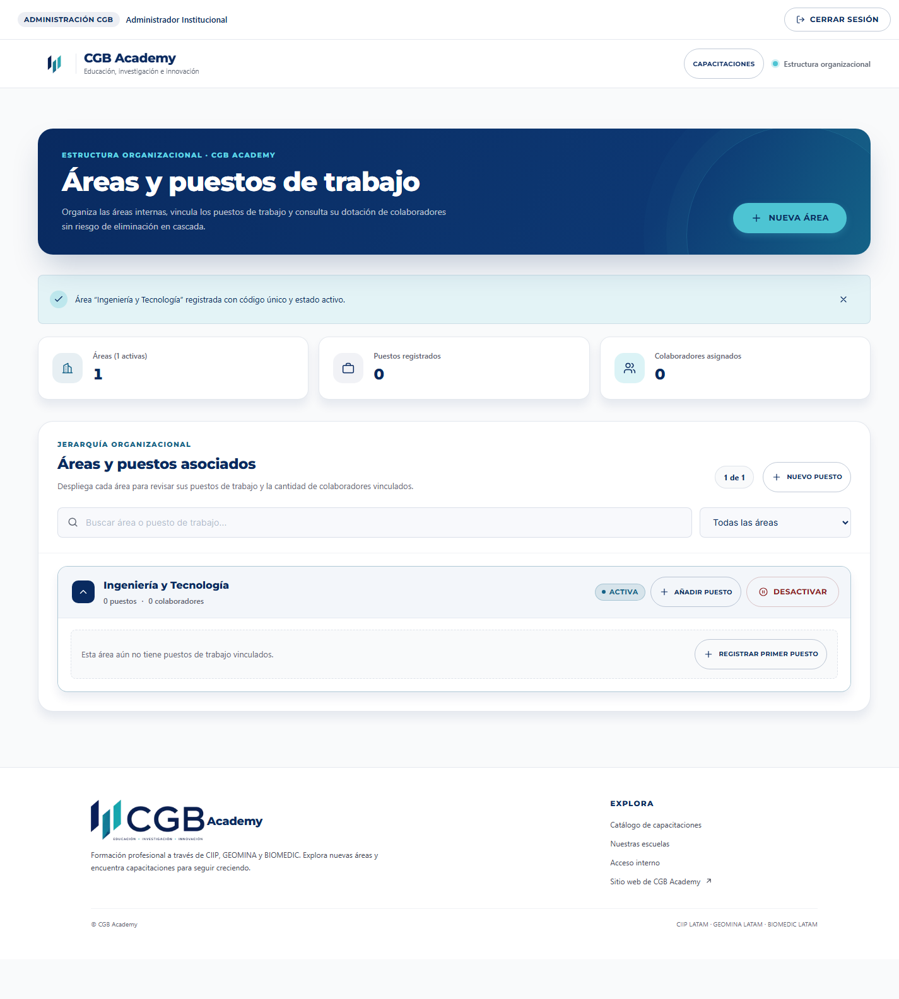
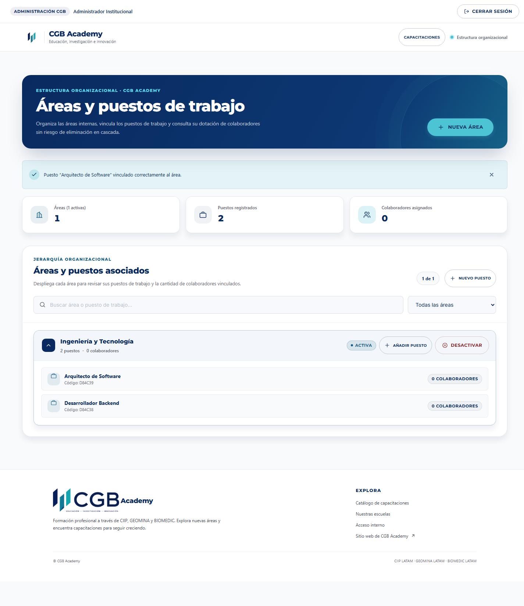
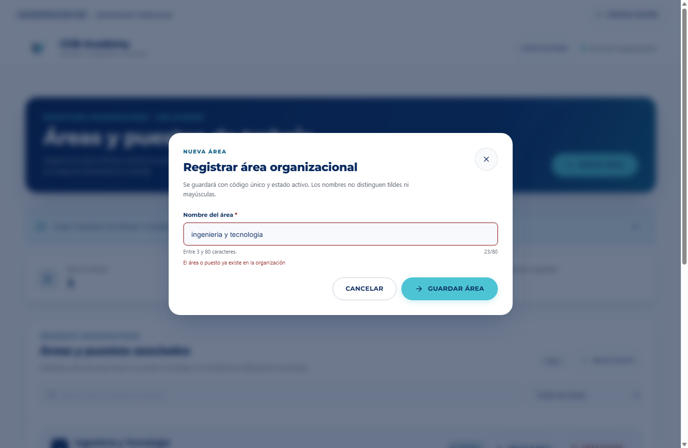
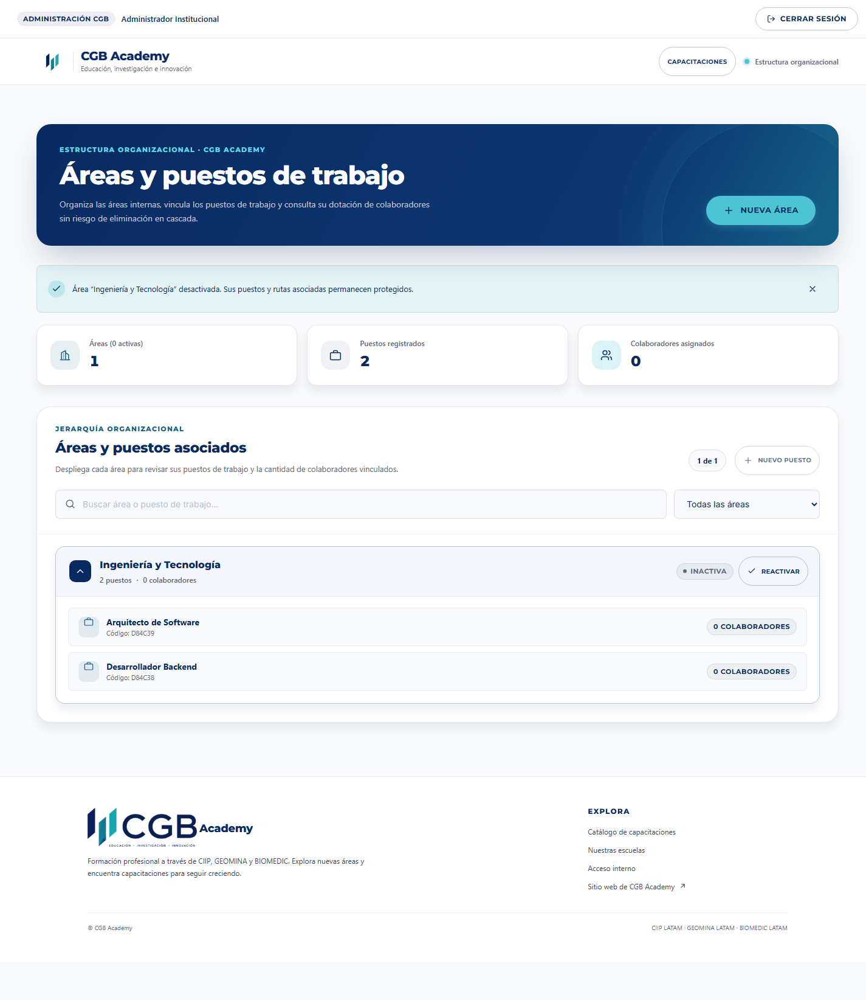
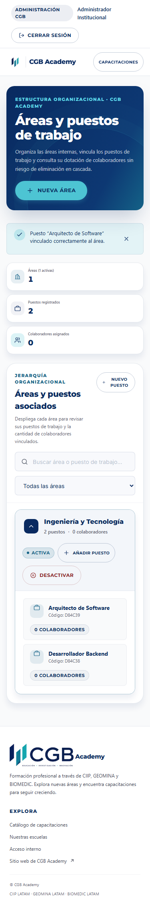

# HU-007 — Crear área y puestos de trabajo (CGB-31)

- **Historia Jira:** [CGB-31](https://cgb-academy.atlassian.net/browse/CGB-31)
- **Subtareas asociadas:** [CGB-32](https://cgb-academy.atlassian.net/browse/CGB-32) (`T1 RED`), [CGB-33](https://cgb-academy.atlassian.net/browse/CGB-33) (`T2 GREEN`), [CGB-34](https://cgb-academy.atlassian.net/browse/CGB-34) (`T3 REFACTOR`), [CGB-35](https://cgb-academy.atlassian.net/browse/CGB-35) (`T4 VALIDACIÓN`)
- **Responsable:** Alex Carpio (`alex164563`, integrado en `main` en `9cc92fa` y `a5918ea`; seguimiento `CGB-35` en PR #21)

---

## 1. Decisiones técnicas, acuerdo del PO y compatibilidad del equipo

1. **Unicidad real en base de datos sin tildes ni mayúsculas:**
   - `Area` y `PuestoTrabajo` en `prisma/schema.prisma` incorporan el campo `nombreClave` normalizado mediante `claveNombre` (sin tildes, minúsculas y espacios colapsados): `@unique` en `Area.nombreClave` y `@@unique([areaId, nombreClave])` en `PuestoTrabajo`.
   - Además de la validación previa en el servicio, el repositorio detecta errores `P2002` de Prisma (`esErrorUnicidadPrisma`) para responder HTTP `409` con `El área o puesto ya existe en la organización` incluso ante solicitudes concurrentes.
2. **Protección contra borrado en cascada — Decisión del PO (`RNF-010`):**
   - Por definición acordada con el Product Owner (registrada en Jira `CGB-31`), dar de baja un área organizacional **no borra en cascada** sus puestos, rutas ni colaboradores: la relación `PuestoTrabajo.area` usa `onDelete: Restrict`.
   - `DELETE /api/organizacion/areas/[id]` bloquea la eliminación con HTTP `409` (`puedeEliminarArea`) si el área tiene puestos asociados, y `PATCH /api/organizacion/areas/[id]` permite desactivar o reactivar el área (`activa: false` / `true`) conservando el historial.
3. **Acuerdo de modelos oficiales con las HU dependientes (`CGB-36` y `CGB-41`):**
   - **Acuerdo registrado con Domingo Quispe (`CGB-36`, HU-008) y Ronaldo Ticona (`CGB-41`, HU-009):** `Area` (`@@map("areas")`) y `PuestoTrabajo` (`@@map("puestos_trabajo")`) son los modelos oficiales del esquema compartido y requieren `nombreClave` generado con `claveNombre()` de `src/lib/organizacion.ts`.
   - `obtenerEstructuraOrganizacional()` en `src/lib/servicio-organizacion.ts` invoca `armarEstructura` dejando preparado el mapa `conteoPorPuesto` (actualmente `0` hasta integrar la relación `Colaborador.puestoId -> PuestoTrabajo.id` de `CGB-41`).
4. **Arquitectura y diseño en 4 capas estrictas ($n \to n-1$):**
   - El detalle de las 4 capas (`Presentación → Controlador → Lógica de negocio → Acceso a datos`), incluyendo la extracción de `ListaAcordeonAreas.tsx`, `ModalesOrganizacion.tsx`, `organizacion-cliente.ts` y `organizacion-http.ts`, se documenta sin duplicación en [`HU007-DISENO-Y-TRAZABILIDAD.md`](./HU007-DISENO-Y-TRAZABILIDAD.md).

---

## 2. Criterios de aceptación (BDD) y Requisitos No Funcionales (RNF)

### 2.1 Matriz de Criterios de Aceptación (CA-01 a CA-04)

| Criterio Jira | Implementación | Verificación automatizada y real |
|---|---|---|
| **CA-01: Creación de nueva área organizacional** | `POST /api/organizacion/areas`, `registrarAreaOrganizacion`, `validarArea`, `ModalNuevaArea` en `/admin/organizacion`. | `tests/organizacion.test.mjs`, `tests/organizacion-api.test.mjs` y captura real `01-area-creada.png`. |
| **CA-02: Asociación de puestos de trabajo a un área** | `POST /api/organizacion/puestos`, `registrarPuestoOrganizacion`, `validarPuesto`, `puedeAgregarPuestoAArea`, `ModalNuevoPuesto`. | `tests/organizacion.test.mjs`, `tests/organizacion-api.test.mjs` y captura real `02-acordeon-puestos.png`. |
| **CA-03: Restricción de duplicados** | `existeNombreDuplicado`, índices únicos `nombreClave` y manejo `P2002`. | `tests/organizacion.test.mjs`, `tests/organizacion-api.test.mjs`, `tests/organizacion-ui.test.mjs` y captura real `03-rechazo-duplicado.png`. |
| **CA-04: Consulta jerárquica de áreas y puestos** | `GET /api/organizacion/areas`, `obtenerEstructuraOrganizacional`, `armarEstructura` y `ListaAcordeonAreas.tsx`. | `tests/organizacion-api.test.mjs`, `tests/organizacion-ui.test.mjs` y captura real `02-acordeon-puestos.png`. |

### 2.2 Comprobación de Requisitos No Funcionales (RNF por ID)

Medidos sobre build de producción (`next build` + `next start`) en `localhost` conectado a MongoDB Atlas (`cgb_academy`), 18/11/2026:

| ID RNF | Requisito No Funcional | Resultado comprobado y límite declarado |
|---|---|---|
| **RNF-001** | Diseño adaptable (Responsive) | `scrollWidth <= innerWidth` sin desplazamiento horizontal en **375 px** (`375/375`), **768 px** (`753/768`) y **1280 px** (`1265/1280`). Evidencia: `05-movil-375px.png`. |
| **RNF-002** | Idioma español | Toda la interfaz, etiquetas `aria-*` y mensajes de error (`MENSAJE_DUPLICADO`, `MENSAJE_AREA_INACTIVA`, `MENSAJE_AREA_CON_PUESTOS`) 100 % en español. |
| **RNF-003** | Infraestructura objetivo (VPS 2 vCPU / 8 GB RAM) | Consultas en paralelo (`Promise.all` de `areas` y `puestos_trabajo` en una sola carga) y cabeceras `Cache-Control: no-store`. |
| **RNF-004** | Contenido ligero (`< 1,5 s`) | Sobre `next start` con Atlas: cargas subsecuentes en **218 ms y 219 ms** (`TTFB` `199–204 ms`); primera carga en frío **1841 ms** (`TTFB` `1725 ms` por conexión inicial a Atlas). *Límite:* medido desde `localhost` contra Atlas, no desde VPS/4G. |
| **RNF-005** | Control de acceso interno por rol y CSRF | `exigirAdministrador` (401/403) en `/api/organizacion/**` + validación `Same-Origin` en mutaciones (`tests/organizacion-api.test.mjs`). |
| **RNF-008** | Consistencia visual CGB | Uso de `CabeceraAdminCgb`, `PieCgb`, tokens CSS (`--brand-navy`, `.kicker-cgb`, `.chip-estado`, `.admin-panel`) y accesibilidad (`aria-expanded`, `role="dialog"`). |
| **RNF-009** | Facilidad de administración (*no-code*) | Gestión gráfica mediante modales guiados (`ModalNuevaArea`, `ModalNuevoPuesto`, `ModalDesactivarArea`), filtros y acordeón sin edición de código. |
| **RNF-010** | Integridad referencial y preservación de historial | `onDelete: Restrict` en `PuestoTrabajo.area`, bloqueo `409` al borrar áreas con puestos (`puedeEliminarArea`) y desactivación lógica con `PATCH` (`04-area-desactivada.png`). |

*(RNF-006 y RNF-007 aplican a autenticación/registro de colaboradores, no a esta HU).*

---

## 3. Evidencia en navegador conectado a MongoDB Atlas (`CGB-35`, 18/11/2026)

Validación ejecutada en `http://localhost:3000/admin/organizacion` (`next start` conectado al clúster `cgb_academy` de MongoDB Atlas con `admin@cgb.latam`). Los registros temporales (`Ingeniería y Tecnología`, `Desarrollador Backend` y `Arquitecto de Software`) se limpiaron al finalizar (`0` restos en Atlas).

| Criterio | Evidencia en navegador (`/admin/organizacion`) |
|---|---|
| **CA-01** Registro de área activa |  |
| **CA-02 y CA-04** Acordeón desplegado con puestos asociados y conteo de colaboradores |  |
| **CA-03** Rechazo de duplicado insensible a tildes y mayúsculas (`ingenieria y tecnologia`) |  |
| **RNF-010** Desactivación lógica (`PATCH`) sin borrado en cascada |  |
| **RNF-001** Vista adaptable en móvil (`375 px`, sin desplazamiento horizontal) |  |

---

## 4. Estado de `prisma db push` en MongoDB Atlas

- **Inspección previa ejecutada (18/11/2026):** Se verificó en modo lectura en `cgb_academy` que las colecciones `areas` y `puestos_trabajo` tienen actualmente `0` documentos preexistentes sin `nombreClave`.
- **Estado de ejecución de `npx prisma db push`:** Pendiente de confirmación expresa del administrador de la base de datos compartida para crear los índices únicos `areas.nombreClave_1` y `puestos_trabajo.areaId_1_nombreClave_1` en Atlas.
