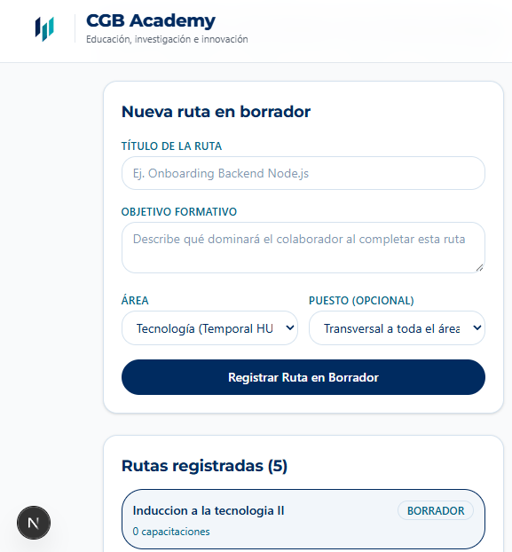

# HU-008 — Crear y secuenciar ruta de onboarding (`CGB-36`)

Responsable: Domingo Quispe (`Dev 2`). Rama: `feature/CGB-36-ruta-onboarding` (PR #10).

## Problema y resultado

CGB Academy necesitaba estructurar rutas de inducción por área y puesto de trabajo compuestas por secuencias correlativas de capacitaciones publicadas (`Paso 1 → Paso 2 → Paso 3`), garantizando prerequisitos antes de iniciar módulos posteriores y activación controlada.

## Diseño por capas (Arquitectura en 4 capas)

Siguiendo la arquitectura monolítica modular en capas del proyecto (donde la capa `n` solo invoca a la capa `n - 1` y se aplica **DIP** + **Adapter** para aislar Prisma):

1. **Capa 1 — Presentación (UI):**
   - `src/app/admin/rutas/ConstructorRutas.tsx` (estado del constructor, formulario y accesibilidad ARIA).
   - `src/app/admin/rutas/ListaPasosRuta.tsx` (lista ordenable con *drag & drop* y controles `Subir`/`Bajar`/`Quitar`).
   - `src/lib/rutas-cliente.ts` (cliente HTTP `fetch` desacoplado de la vista).
2. **Capa 2 — Aplicación / Entrada (`page.tsx` y Route Handlers):**
   - `src/app/admin/rutas/page.tsx`: Server Component que consulta datos iniciales a través de `obtenerServicioRutas().obtenerDatosConstructor()` (**no importa `prisma` directamente**).
   - `src/app/api/rutas/route.ts`, `src/app/api/rutas/[id]/route.ts`, `src/app/api/rutas/[id]/activar/route.ts`: controladores delgados protegidos con `exigirAdministrador`, apoyados en `src/lib/rutas-http.ts`.
3. **Capa 3 — Dominio / Lógica de negocio:**
   - `src/lib/rutas-onboarding.ts`: módulo puro sin imports externos (`validarDatosRuta`, `construirPasosSecuenciales`, `puedeIniciarPaso`, `moverPasoSecuencia` y `crearServicioRutasOnboarding`, incluyendo filtro por estado y datos del constructor).
4. **Capa 4 — Persistencia / Datos (Adapter):**
   - `src/lib/rutas-onboarding-prisma.ts` (`crearRepositorioRutasPrisma`): implementa el contrato segregado `RepositorioRutasOnboarding` usando `PrismaClient` y transacciones atómicas.
   - `prisma/schema.prisma`: modelos `RutaOnboarding` (`rutas_onboarding`) y `PasoRuta` (`pasos_ruta`).

## Criterios de Aceptación y Trazabilidad de Pruebas

| Criterio Jira | Implementación y evidencia | Prueba en `tests/rutas-onboarding.test.mjs` |
|---|---|---|
| **CA-01:** Registro de nueva ruta en estado `BORRADOR` vinculada a área/puesto | `POST /api/rutas`, `validarDatosRuta`, `crearRuta` | `HU-008 CA-01: registra una nueva ruta en estado BORRADOR...` y `HU-008 CA-01: rechaza rutas con título/objetivo inválidos...` |
| **CA-02:** Secuenciación correlativa de capacitaciones publicadas | `PUT /api/rutas/[id]`, `construirPasosSecuenciales`, `secuenciarCapacitaciones` | `HU-008 CA-02: secuencia capacitaciones publicadas en orden correlativo...` y `HU-008 CA-02: impide secuenciar capacitaciones en BORRADOR o repetidas...` |
| **CA-03:** Correlatividad y prerequisitos entre pasos | `puedeIniciarPaso` (la aplicación en el flujo del colaborador depende de `CGB-51`/`CGB-56`) | `HU-008 CA-03: bloquea el Paso 2 hasta completar el Paso 1...` |
| **CA-04:** Activación con al menos una capacitación asociada | `POST /api/rutas/[id]/activar`, `activarRuta` (la asignación automática a colaboradores pertenece a `CGB-41`) | `HU-008 CA-04: activa una ruta solo si tiene al menos una capacitación asociada` |
| **Refactor T3 (UI):** Reordenamiento inmutable | `moverPasoSecuencia` + `ListaPasosRuta.tsx` | `HU-008 T3 REFACTOR: reordena pasos de forma inmutable...` |
| **Control de cambios (PO):** Bloqueo de secuencia en rutas `ACTIVA` | `secuenciarCapacitaciones` rechaza edición en `ACTIVA`; UI en modo solo lectura | `HU-008: bloquea la modificación o reordenamiento de pasos cuando la ruta ya está ACTIVA` |
| **Arquitectura en capas (DIP):** Filtro en servicio y datos del constructor | `listarRutas(estadoFiltro)` y `obtenerDatosConstructor()` | `HU-008: servicio filtra rutas por estado y expone datos del constructor sin acoplar la página a Prisma` |

## Decisiones de Control de Cambios y Alcance

- **Inmutabilidad de rutas `ACTIVA`:** para no romper el avance ni los prerequisitos de colaboradores en `CGB-51`, una vez activada la ruta (`ACTIVA`), se bloquea toda modificación o reordenamiento de pasos tanto en el dominio como en `/admin/rutas`. (Pendiente ratificación formal del PO registrada en Jira `CGB-36`, junto con la confirmación del actor `"Gestor de Capacitación"`).
- **Dependencias entre historias (`CA-03` y `CA-04`):** `HU-008` implementa la regla pura `puedeIniciarPaso` (`CA-03`) y la activación de ruta (`CA-04`); el bloqueo en tiempo real al cursar módulos corresponde a `CGB-51`/`CGB-56` y la asignación al registrar personal corresponde a `CGB-41`.
- **Integración con `CGB-31`:** en el esquema temporal propio, `PuestoTrabajo.area` aún usa `Cascade`; al integrar `CGB-31` desde `main` se adoptará su `onDelete: Restrict` y `nombreClave`, conservando `rutas RutaOnboarding[]`.

## Base de Datos Compartida (MongoDB Atlas), TDD y Uso de IA

- **Uso de MongoDB Atlas:** **no se ejecutó `prisma db push`** ni se modificaron esquemas/colecciones permanentes en Atlas. Únicamente se corrió `npx prisma generate` en local. Con autorización del usuario (Domingo), se levantó la app localmente contra Atlas para probar `/admin/rutas` en vivo, creando y eliminando inmediatamente los registros temporales (`Tecnología (Temporal HU-008)` e `Induccion a la tecnologia II`), dejando intactas las 4 rutas originales del equipo.
- **Trazabilidad TDD:** `c5194f7` (RED) → `6d004a9` (GREEN) → `04b5b1a` (REFACTOR + `feat` de `ConstructorRutas.tsx`) → `2e9232c` (`fix` bloqueo `ACTIVA` y compatibilidad Atlas) → `c74cf19` (`docs`) → refactor final por capas y accesibilidad.
- **Verificación actual:** `npm test` (**77/77 pruebas pasan**, 9 de `HU-008`), `npm run lint` (**0 errores**), `npx next build --webpack` (compilación Next.js 16 y TypeScript exitosa).
- **Declaración de uso de IA (diapositivas 37–38):** Se utilizó asistente de IA (Antigravity / Gemini) como apoyo para pruebas TDD, refactorización por capas, documentación y diagnóstico en Atlas, con revisión humana del autor y verificación local completa.

## Evidencia Visual en `/admin/rutas` (MongoDB Atlas)

### 1. Registro en estado `BORRADOR` (`CA-01`)

### 2. Secuenciación de 3 capacitaciones publicadas (`CA-02`)

### 3. Activación de ruta y bloqueo de modificación en estado `ACTIVA` (`CA-04` + Control de Cambios)

