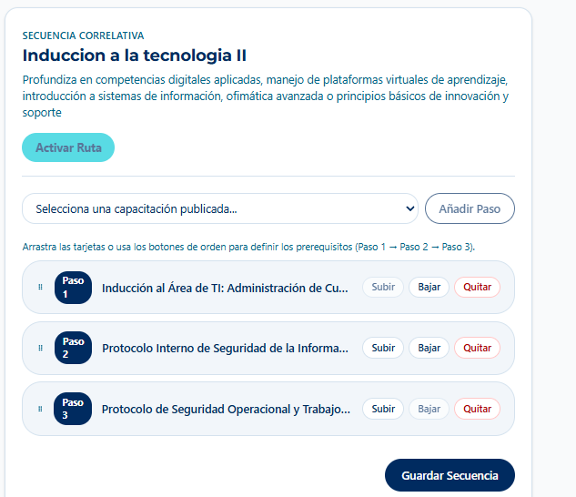
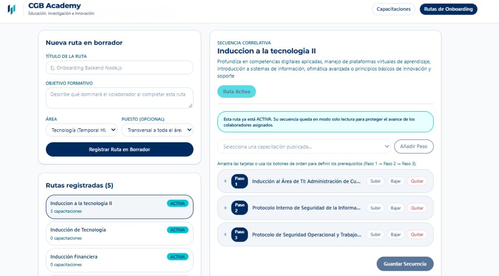

# HU-008 — Crear y secuenciar ruta de onboarding (`CGB-36`)

Responsable: Domingo Quispe (`Dev 2`). Rama: `feature/CGB-36-ruta-onboarding` (PR #10).

## Problema y resultado

CGB Academy necesitaba estructurar rutas de inducción por área y puesto de trabajo compuestas por secuencias correlativas de capacitaciones publicadas (`Paso 1 → Paso 2 → Paso 3`), garantizando prerequisitos antes de iniciar módulos posteriores y activación controlada.

Esta entrega añade:
- Modelos `RutaOnboarding` (`rutas_onboarding`) y `PasoRuta` (`pasos_ruta`) en `prisma/schema.prisma`, compatibles con `Area` / `PuestoTrabajo` (`CGB-31`), `Colaborador` (`CGB-41`) y los documentos iniciales existentes en Atlas (`nombre`, `descripcion`, `activa`).
- Lógica de dominio pura con inyección de dependencias (`DIP` + `ISP`) en `src/lib/rutas-onboarding.ts` y adaptador Prisma (`Adapter`) con transacciones atómicas en `src/lib/rutas-onboarding-prisma.ts`.
- Endpoints administrativos protegidos (`exigirAdministrador`): `GET / POST /api/rutas`, `GET / PUT /api/rutas/[id]` y `POST /api/rutas/[id]/activar`, con helper compartido `src/lib/rutas-http.ts`.
- Constructor visual `/admin/rutas` (`page.tsx` + `ConstructorRutas.tsx`) con reordenamiento por *drag & drop* y controles accesibles (`Subir` / `Bajar` / `Quitar`).

## Criterios de Aceptación y Trazabilidad de Pruebas

| Criterio Jira | Implementación y evidencia | Prueba en `tests/rutas-onboarding.test.mjs` |
|---|---|---|
| **CA-01:** Registro de nueva ruta en estado `BORRADOR` vinculada a área/puesto | `POST /api/rutas`, `validarDatosRuta`, `crearRuta` | `HU-008 CA-01: registra una nueva ruta en estado BORRADOR...` y `HU-008 CA-01: rechaza rutas con título/objetivo inválidos...` |
| **CA-02:** Secuenciación correlativa de capacitaciones publicadas | `PUT /api/rutas/[id]`, `construirPasosSecuenciales`, `secuenciarCapacitaciones` | `HU-008 CA-02: secuencia capacitaciones publicadas en orden correlativo...` y `HU-008 CA-02: impide secuenciar capacitaciones en BORRADOR o repetidas...` |
| **CA-03:** Correlatividad y prerequisitos entre pasos | `puedeIniciarPaso` (valida pasos previos completados) | `HU-008 CA-03: bloquea el Paso 2 hasta completar el Paso 1...` |
| **CA-04:** Activación con al menos una capacitación asociada | `POST /api/rutas/[id]/activar`, `activarRuta` | `HU-008 CA-04: activa una ruta solo si tiene al menos una capacitación asociada` |
| **Refactor T3 (UI):** Reordenamiento inmutable | `moverPasoSecuencia` + lista *drag & drop* | `HU-008 T3 REFACTOR: reordena pasos de forma inmutable...` |
| **Control de cambios (PO):** Bloqueo de secuencia en rutas `ACTIVA` | `secuenciarCapacitaciones` rechaza edición en `ACTIVA`; UI en modo solo lectura | `HU-008: bloquea la modificación o reordenamiento de pasos cuando la ruta ya está ACTIVA` |

## Decisión de Control de Cambios (Revisión PR #10)

Durante la revisión se evaluó el impacto de permitir reordenar una ruta ya `ACTIVA` sobre el progreso de colaboradores en `CGB-51`. Por decisión acordada, **una vez activada la ruta (`ACTIVA`), su secuencia queda en modo solo lectura** tanto en dominio (`ErrorRutaOnboarding`) como en la interfaz `/admin/rutas`, evitando desfasar el avance o los prerequisitos de colaboradores asignados.

## Evidencia TDD, Validaciones y Uso de IA

- **RED (`c5194f7`):** `tests/rutas-onboarding.test.mjs` ejecutado antes de la implementación (`ERR_MODULE_NOT_FOUND`).
- **GREEN (`6d004a9`):** modelos Prisma, dominio, adaptador y `/api/rutas/*` aprobando pruebas de `HU-008` y Sprint 1.
- **REFACTOR (`04b5b1a`):** extracción de `src/lib/rutas-http.ts`, `moverPasoSecuencia` y constructor visual `/admin/rutas` *(nota: el commit `04b5b1a` incluye tanto refactor HTTP como la funcionalidad `feat` del constructor visual `ConstructorRutas.tsx`)*.
- **Verificación actual:**
  - `npm test`: **76/76 pruebas pasan** (8 de `HU-008` + 68 de Sprint 1).
  - `npm run lint`: **0 errores**.
  - `npx next build --webpack`: compilación de producción Next.js 16 y TypeScript exitosa.
- **Declaración de uso de IA (diapositivas 37–38):** Se utilizó asistente de IA (Antigravity / Gemini) como apoyo para diseño, pruebas TDD, documentación y refactorización, con revisión humana del código y ejecución local verificada de `npm test`, `npm run lint`, `npx next build --webpack` y pruebas reales sobre MongoDB Atlas.

## Evidencia Visual en `/admin/rutas` (MongoDB Atlas)

Las capturas se validaron sobre servidor local conectado a MongoDB Atlas con sesión `ADMINISTRADOR`. Los registros temporales creados durante la prueba (`Tecnología (Temporal HU-008)` y `Induccion a la tecnologia II`) fueron eliminados al finalizar para conservar intacta la base compartida del equipo.

### 1. Registro en estado `BORRADOR` (`CA-01`)

### 2. Secuenciación de 3 capacitaciones publicadas (`CA-02`)

### 3. Activación de ruta y bloqueo de modificación en estado `ACTIVA` (`CA-04` + Decisión PO)

