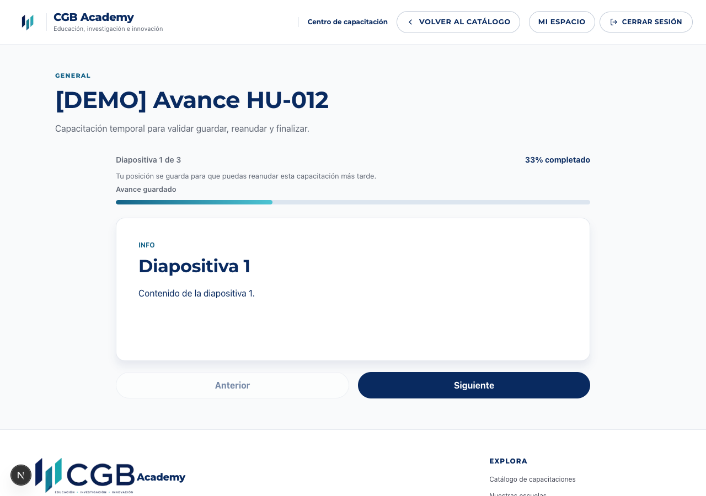
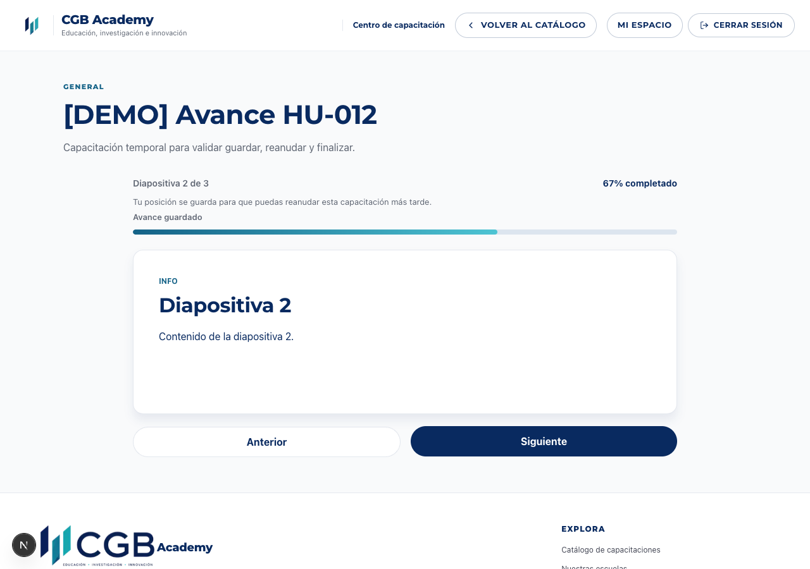
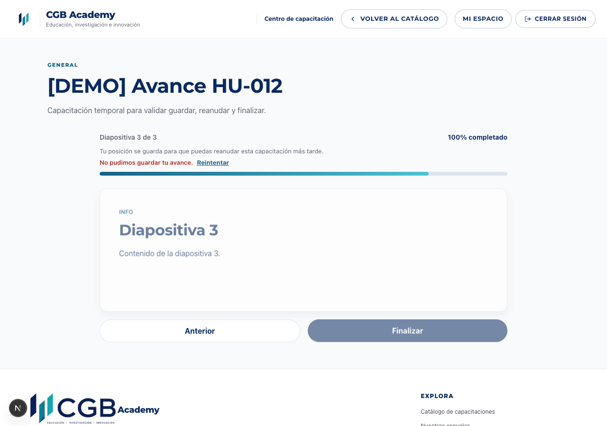
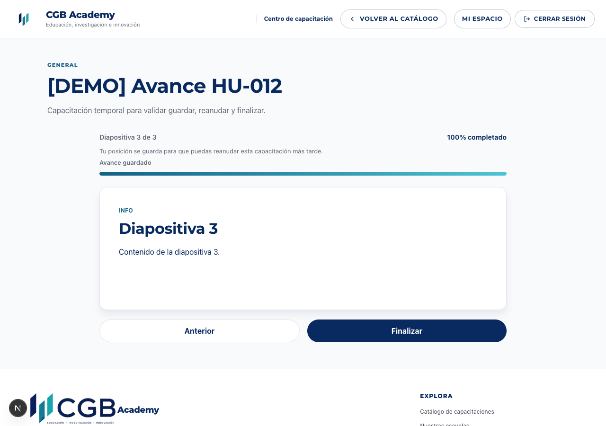
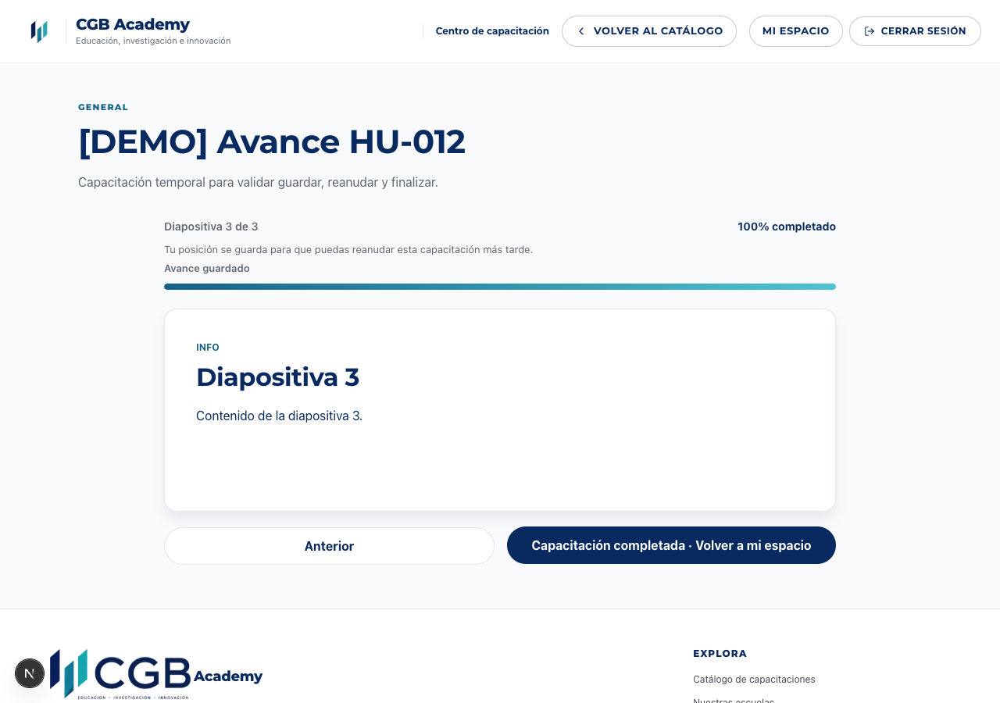

# HU-012 — Completar capacitación interna y registrar avance (CGB-56)

Rama: `feature/CGB-56-completar-capacitacion`. Tareas técnicas: CGB-57 (RED), CGB-58 (GREEN), CGB-59 (REFACTOR), CGB-60 (VALIDACIÓN).

## Resultado

Un colaborador autenticado recorre una capacitación interna publicada. Cada slide al que navega se confirma y se guarda. Al volver a abrirla, retoma en el último slide confirmado. La capacitación pasa a Completada solo cuando se confirmaron todos los slides y se pulsa Finalizar desde el último. La interfaz informa que la posición se guarda para reanudar.

Componentes:

- Modelo `ProgresoCapacitacion` (clave única usuario + capacitación) y `Capacitacion.prerrequisitos`.
- Reglas puras en `src/lib/progreso-capacitacion.ts`; orquestación de endpoints en `src/lib/servicio-progreso.ts`.
- API: `GET` y `PUT /api/colaborador/capacitaciones/[id]/progreso`, `POST .../progreso/finalizar`.
- Interfaz: `VisorCapacitacionInterna` en `/colaborador/capacitaciones/[id]`, con estados de guardado, error y reintento.
- Autorización: `exigirSesionInterna`. El avance se asocia siempre a la sesión, nunca a un identificador enviado en el cuerpo.

## Criterios de aceptación

| Criterio Jira | Evidencia (prueba) |
|---|---|
| CA1 Guardar avance | `CA-01 Guardar avance`; UI `Guardar: cada slide al que se navega se confirma` |
| CA2 Reanudar | `CA-02 Reanudar`; UI `Reanudar: abre en el último slide confirmado y sin avance en el primero` |
| CA3 Finalización y prerrequisitos | `CA-03 Finalización` (dos pruebas), `CA-03 Prerrequisitos` (dos pruebas); UI `Finalizar` (tres pruebas) |
| CA4 Privacidad y transparencia | `CA-04 Privacidad` (tres pruebas: sin sesión, aislamiento entre cuentas, origen ajeno); UI `Privacidad: informa que la posición se guarda` |
| CA5 Integridad | `CA-05 Integridad` (repetición sin duplicar ni sumar; porcentaje ≤ 100 %) |

Pruebas adicionales: entradas inválidas y capacitaciones no asignadas se rechazan sin escribir; un fallo del repositorio devuelve error genérico; estados accesibles con reintento.

## Integridad ante concurrencia (CGB-59)

Guardar y finalizar usan control optimista (`escribirProgreso`): se actualiza solo si `updatedAt` no cambió desde la lectura. Si otra solicitud se adelantó, se relee y se recalcula, hasta 5 intentos; después responde 409. La creación concurrente se resuelve con el índice único (`P2002`) y reintento. Así una solicitud con datos viejos no pisa el avance de otra.

## Verificación (17 de noviembre de 2026)

- `npm test`: **92 pruebas pasan, 0 fallan** (24 de HU-012 en `tests/progreso-capacitacion.test.mjs` y `tests/visor-progreso.test.mjs`, incluidas 4 de concurrencia).
- `npx tsc --noEmit` y `npx eslint src tests`: sin errores.
- **MongoDB Atlas real** (`prisma db push` aplicado; colección `progreso_capacitaciones` con índice único usuario + capacitación). Con datos temporales, ya eliminados (0 restos):
  - Flujo: sin sesión 401; sin avance inicia en el slide 1; repetir confirmación deja un registro; reanuda en el slide 2 (67 %); otra cuenta no ve ese avance; finalizar antes de tiempo da 409; tras confirmar todos se completa con 100 %.
  - Concurrencia: 3×slide 1, 4×slide 2, 2×slide 3 y 2×Finalizar simultáneos dieron todas 200, un solo registro, `[1,2,3]` y `COMPLETADA`.

## Evidencia en navegador (17 de noviembre de 2026)

Capacitación temporal `[DEMO] Avance HU-012` (3 slides, sin microtest) en MongoDB Atlas, cuenta de colaborador de pruebas del seed y `npm run dev` en localhost, automatizado con Playwright. La capacitación y su progreso se eliminaron al terminar. Para el error se bloqueó la solicitud de guardado desde el navegador.

| CA | Captura |
|---|---|
| CA1 Guardar |   |
| CA2 Reanudar |  |
| CA5 Integridad / error |   |
| CA3 Finalización |  |
| CA4 Transparencia | Todas las capturas muestran «Tu posición se guarda para que puedas reanudar esta capacitación más tarde.» |

## Cambio en base compartida (`prisma db push`)

- **Entorno:** MongoDB Atlas, base `cgb_academy` (la misma de `DATABASE_URL`).
- **Qué se aplicó:** colección `progreso_capacitaciones` con índice único usuario + capacitación, y el campo `prerrequisitos` de `Capacitacion`. No se modificaron ni borraron colecciones existentes.
- **Quién lo autorizó:** el administrador del proyecto (Product Owner y Scrum Master), antes de ejecutar el comando. Lo ejecutó el autor de la rama.
- **Datos temporales:** se declara 0 restos tras la limpieza; el método de comprobación no quedó registrado en su momento.

## Alcance y pendientes

- Verificada en el navegador (ver «Evidencia en navegador»). No hay E2E automatizado.
- Faltan la revisión por pares, la aprobación independiente y la integración mediante Pull Request (CGB-60).
- La DoD es la del equipo (PR #12); esta rama no la define. Validar la asignación de capacitaciones a la ruta del colaborador queda para cuando CGB-36 y CGB-51 estén en `main`. Diseño por capas y trazabilidad: `docs/HU012-DISENO-Y-TRAZABILIDAD.md`.
- CGB-51 consumirá este avance.
