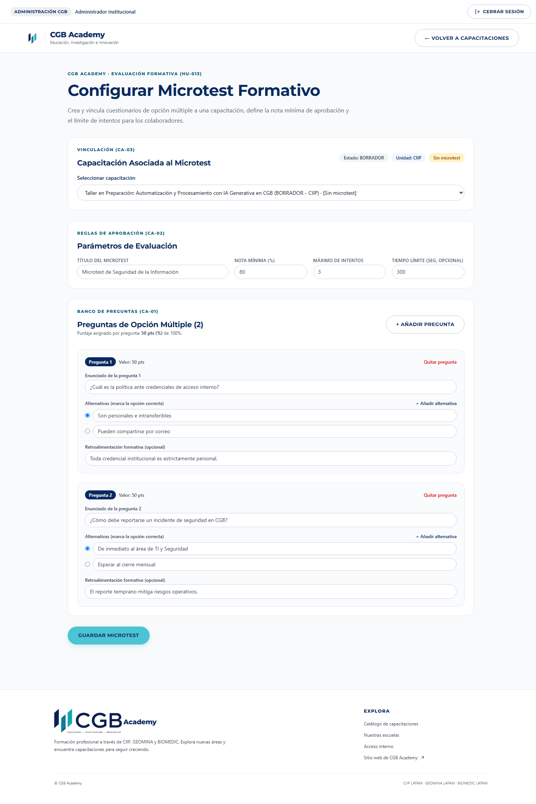
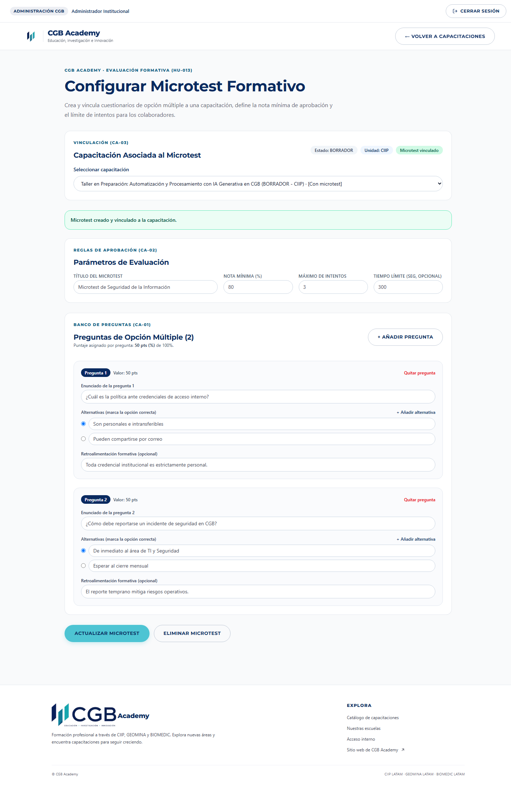
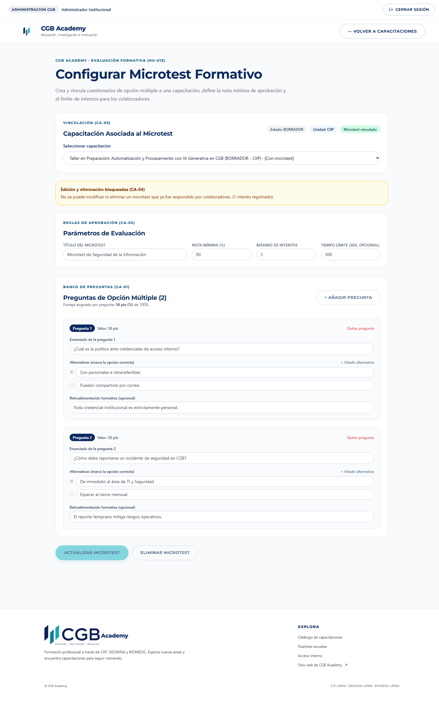
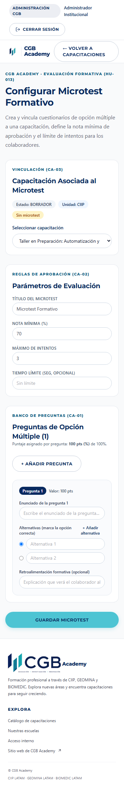

# HU-013 — Configurar microtest formativo (CGB-61)

- **Rama:** `feature/CGB-61-configurar-microtest` (basada en `origin/main` sobre `79e3ec1`)
- **Issue en Jira:** [CGB-61](https://cgb-academy.atlassian.net/browse/CGB-61)
- **Subtareas TDD:** [CGB-62](https://cgb-academy.atlassian.net/browse/CGB-62) (`T1 RED`), [CGB-63](https://cgb-academy.atlassian.net/browse/CGB-63) (`T2 GREEN`), [CGB-64](https://cgb-academy.atlassian.net/browse/CGB-64) (`T3 REFACTOR`), [CGB-65](https://cgb-academy.atlassian.net/browse/CGB-65) (`T4 VALIDACIÓN`)
- **Responsable:** Alex Carpio (`alex164563`, PR #17)

---

## 1. Decisiones técnicas, acuerdo con el PO y compatibilidad con `CGB-66`

1. **Integridad de evaluaciones respondidas — Decisión del PO (`CA-04` / `RNF-010`):**
   - Por definición de negocio, mientras un microtest formativo tiene `0` intentos registrados por colaboradores, el administrador puede editar sus preguntas, alternativas, nota mínima o eliminarlo (`PUT / DELETE /api/microtests/[id]`).
   - En cuanto existe al menos un intento calificado (`totalIntentos > 0`), tanto el dominio (`puedeModificarMicrotest`) como el servicio (`ErrorConfiguracionMicrotest` con HTTP `409 Conflict`) y la interfaz (`ConstructorMicrotest.tsx`) bloquean la edición y la eliminación para preservar la trazabilidad de las calificaciones históricas.
2. **Propiedad de modelos oficiales y acuerdo con `CGB-66` (`HU-014: Realizar microtest formativo`):**
   - **Dueño de los datos (`ARQ-06`):** Con `CGB-61` bloqueando a `CGB-66` en Jira, **esta HU (`CGB-61`, PR #17) es la dueña oficial** de los modelos `PreguntaEvaluacion` (tipo embebido con `id`, `enunciado`, `opciones`, `correcta` base 0 y `retroalimentacion`), `Evaluacion` (`@@map("evaluaciones")`, `capacitacionId @unique`, `onDelete: Restrict`) e `IntentoEvaluacion` (`@@map("intentos_evaluacion")`, `@@unique([usuarioId, evaluacionId, numero])`, `onDelete: Restrict` hacia `Evaluacion` y `User`). Se integra primero en `main` y `CGB-66` (PR #13) adopta estos modelos oficiales.
   - **Protección contra borrado en cascada (`DIS-14` / `RNF-010`):** Tanto `Evaluacion.capacitacion` como `IntentoEvaluacion.evaluacion` e `IntentoEvaluacion.usuario` usan `onDelete: Restrict`, alineado con `CGB-31` y `CGB-56`, impidiendo que borrar un usuario o una capacitación elimine en silencio evaluaciones o calificaciones históricas.
3. **Arquitectura en 4 capas estrictas ($n \to n-1$):**
   - El detalle de las 4 capas (`Presentación → Controlador → Lógica de negocio → Acceso a datos`), incluyendo la extracción de `TarjetaPreguntaMicrotest.tsx`, `microtests-cliente.ts` y `microtests-http.ts`, se documenta sin duplicación en [`HU013-DISENO-Y-TRAZABILIDAD.md`](./HU013-DISENO-Y-TRAZABILIDAD.md).

---

## 2. Criterios de Aceptación (BDD) y Requisitos No Funcionales (RNF)

### 2.1 Matriz de Criterios de Aceptación (CA-01 a CA-04)

| Criterio | Escenario BDD (Dado / Cuando / Entonces) | Archivo de prueba | Caso verificado | Estado |
| :--- | :--- | :--- | :--- | :--- |
| **CA-01** | **Creación de banco de preguntas y alternativas:** Dado que el administrador edita un microtest, cuando añade preguntas con opciones indicando la alternativa correcta y su puntaje/retroalimentación, entonces la evaluación se guarda estructurada. | `tests/configuracion-microtest.test.mjs` `tests/configuracion-microtest-api.test.mjs` `tests/configuracion-microtest-ui.test.mjs` | `CA-01: acepta preguntas con opciones múltiples...` `CA-01, CA-02 y CA-03: POST /api/microtests guarda preguntas...` Captura `01-constructor-preguntas.png` | ✅ PASS |
| **CA-02** | **Configuración de puntaje mínimo de aprobación:** Dado que se configura la evaluación, cuando el administrador define la nota mínima (1–100%) y número máximo de intentos (1–10), entonces el sistema impone la regla de validación. | `tests/configuracion-microtest.test.mjs` `tests/configuracion-microtest-api.test.mjs` | `CA-02: valida la nota mínima de aprobación (1-100%)...` Captura `01-constructor-preguntas.png` | ✅ PASS |
| **CA-03** | **Asociación del microtest a la capacitación:** Dado que existe una capacitación en Borrador, cuando se vincula el microtest al final de la unidad, entonces el test queda asociado de forma única (`capacitacionId @unique`). | `tests/configuracion-microtest.test.mjs` `tests/configuracion-microtest-api.test.mjs` `tests/configuracion-microtest-ui.test.mjs` | `CA-03: impide crear un segundo microtest para la misma capacitación (409)...` Captura `02-microtest-vinculado.png` | ✅ PASS |
| **CA-04** | **Edición y eliminación de evaluaciones:** Dado que una evaluación aún no ha sido respondida por alumnos, cuando el administrador modifica o elimina el microtest, entonces se actualiza respetando la integridad; si ya existen intentos, bloquea cambios con `409 Conflict`. | `tests/configuracion-microtest.test.mjs` `tests/configuracion-microtest-api.test.mjs` `tests/configuracion-microtest-ui.test.mjs` | `CA-04: PUT y DELETE permiten editar y eliminar mientras no existan intentos...` Captura `03-bloqueo-con-intentos.png` | ✅ PASS |

### 2.2 Comprobación de Requisitos No Funcionales (RNF por ID)

Medidos sobre build de producción (`next build` + `next start`) en `localhost` conectado a MongoDB Atlas (`cgb_academy`), 18/11/2026:

| ID RNF | Requisito No Funcional | Resultado comprobado y límite declarado |
|---|---|---|
| **RNF-001** | Diseño adaptable (Responsive) | `scrollWidth <= innerWidth` sin desplazamiento horizontal en **375 px** (`375/375`), **768 px** (`753/768`) y **1280 px** (`1265/1280`). Evidencia: `04-movil-375px.png`. |
| **RNF-002** | Idioma español | Interfaz, etiquetas `aria-label` y mensajes de error (`MENSAJE_MICROTEST_DUPLICADO`, `MENSAJE_MICROTEST_CON_INTENTOS`) 100 % en español. |
| **RNF-003** | Infraestructura objetivo (VPS 2 vCPU / 8 GB RAM) | Preguntas embebidas (`PreguntaEvaluacion[]`) en un documento `Evaluacion` sin `JOIN` costosos y cabeceras `Cache-Control: no-store`. |
| **RNF-004** | Contenido ligero (`< 1,5 s`) | Sobre `next start` con Atlas: cargas subsecuentes en **215 ms y 221 ms** (`TTFB` `200–201 ms`); primera carga en frío **1604 ms** (`TTFB` `1405 ms` por conexión inicial a Atlas). *Límite:* medido desde `localhost` contra Atlas, no desde VPS/4G. |
| **RNF-005** | Seguridad de acceso interno y CSRF | `exigirAdministrador` (401/403) + validación `Same-Origin` en `POST`, `PUT` y `DELETE` (`tests/configuracion-microtest-api.test.mjs`). |
| **RNF-008** | Consistencia visual CGB | Uso de `CabeceraAdminCgb`, `PieCgb`, `.publicacion-panel`, `.kicker-cgb`, `.boton-primario` y alertas accesibles (`role="alert"`, `role="status"`). |
| **RNF-009** | Facilidad de administración (*no-code*) | Construcción visual dinámica de preguntas, opciones, selección de respuesta correcta y cálculo automático de puntaje en `/admin/microtests`. |
| **RNF-010** | Integridad de información y calificaciones | `capacitacionId @unique`, `onDelete: Restrict` en `Evaluacion.capacitacion`, `IntentoEvaluacion.evaluacion` e `IntentoEvaluacion.usuario`, y bloqueo `409 Conflict` cuando existen intentos (`03-bloqueo-con-intentos.png`). |

*(RNF-006 y RNF-007 aplican a autenticación/registro de colaboradores, no a esta HU).*

---

## 3. Evidencia en navegador conectado a MongoDB Atlas (`CGB-65`, 18/11/2026)

Validación ejecutada en `http://localhost:3000/admin/microtests` (`next start` conectado al clúster `cgb_academy` de MongoDB Atlas con la sesión `admin@cgb.latam`). Los registros temporales creados durante la prueba se eliminaron al finalizar (`0` documentos restantes en `evaluaciones` e `intentos_evaluacion`).

| Criterio | Evidencia en navegador (`/admin/microtests`) |
|---|---|
| **CA-01 y CA-02** Constructor dinámico con preguntas, opciones, alternativa correcta, puntaje por pregunta (`50 pts`) y nota mínima (`80%`) |  |
| **CA-03** Microtest guardado y vinculado a capacitación en `BORRADOR` |  |
| **CA-04 y RNF-010** Bloqueo de edición y eliminación cuando existen intentos registrados |  |
| **RNF-001** Vista adaptable en móvil (`375 px`, sin desplazamiento horizontal) |  |

---

## 4. Verificación Técnica y Bitácora en MongoDB Atlas

1. **Cliente Prisma y Tipado:** `npx prisma generate` y `npx tsc --noEmit` (`0` errores).
2. **Linter:** `npm run lint -- --max-warnings=0` (`0` advertencias, `0` errores).
3. **Suite de pruebas:** `npm test` → **134/134 pruebas pasando** (incluyendo las 12 pruebas de HU-013 y las 122 de `main`).
4. **Compilación de producción:** `npm run build` exitoso.
5. **Estado de colecciones y `prisma db push` en MongoDB Atlas (`cgb_academy`, `GC-10`):** Se inspeccionó en modo lectura el clúster `cgb_academy` comprobando que `evaluaciones` (índice único `evaluaciones_capacitacionId_key`) e `intentos_evaluacion` (índice único `intentos_evaluacion_usuarioId_evaluacionId_numero_key`) existen y tienen `0` documentos preexistentes. Esta rama no ejecutó `npx prisma db push`; cualquier ejecución futura sobre la base compartida requiere confirmación expresa del administrador de la base de datos.
6. **Declaración de uso de IA:** Se empleó Antigravity / Gemini bajo guía del responsable (Alex Carpio) para estructurar las 4 capas, extraer `TarjetaPreguntaMicrotest.tsx`, `microtests-http.ts` y `microtests-cliente.ts`, redactar pruebas y ejecutar verificaciones locales y contra Atlas.
