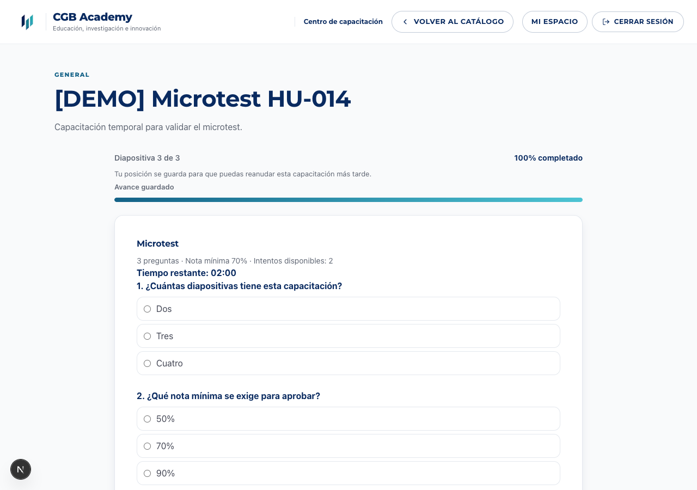
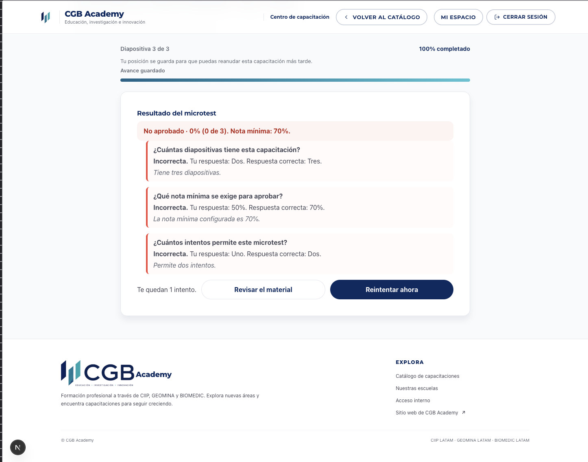
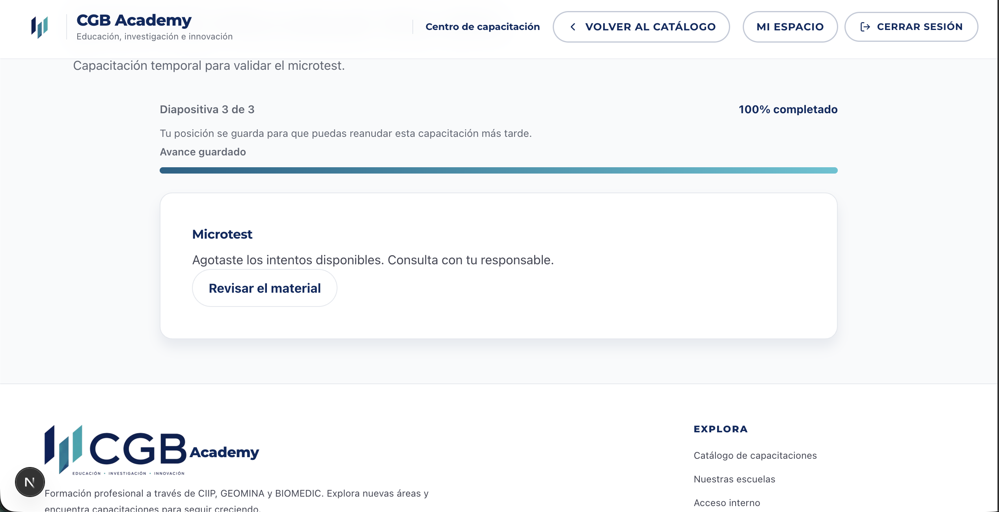
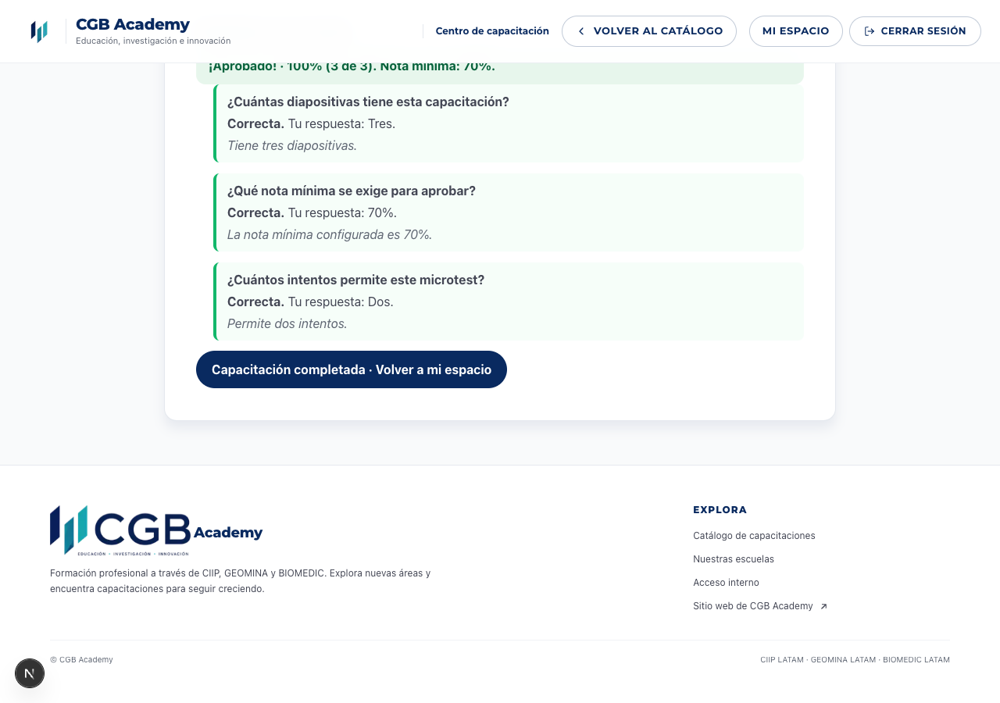
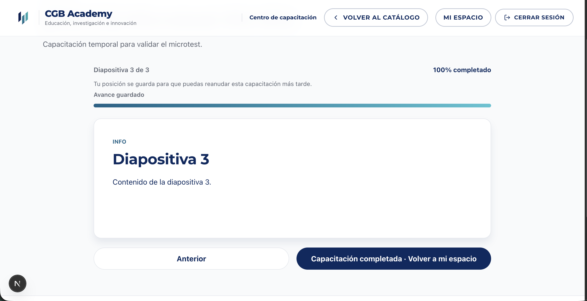
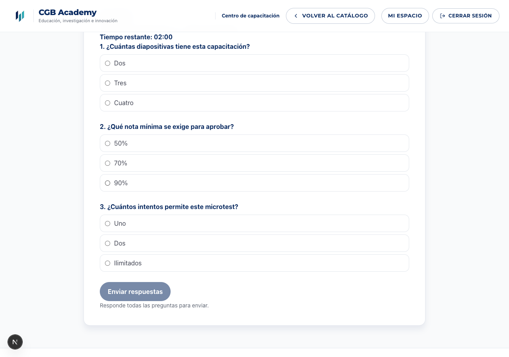

# HU-014 — Realizar microtest formativo interactivo (CGB-66)

Rama: `feature/CGB-66-realizar-microtest`, creada sobre `feature/CGB-56-completar-capacitacion` (PR #9) porque el microtest completa el avance que define HU-012. Integrar después de ese PR.

## Historia

Como colaborador, quiero resolver el microtest al finalizar las diapositivas, para validar mi aprendizaje y obtener la aprobación del módulo.

## Criterios de aceptación y evidencia

| CA | Evidencia |
|---|---|
| CA-01 Interfaz interactiva | `tests/microtest-ui.test.mjs`: preguntas de opción múltiple, envío bloqueado hasta responder todas, temporizador opcional, y «Iniciar microtest» en el último slide. API: no se puede evaluar sin concluir las diapositivas (409). |
| CA-02 Calificación e informe | `tests/microtest.test.mjs` (`CA-02`, 2 pruebas): puntaje, aciertos, respuesta correcta y retroalimentación por pregunta. UI: informe de resultados. |
| CA-03 Aprobación y nota | `CA-03` (2 pruebas): con la nota mínima (o más) el intento queda `aprobado`, se guarda el puntaje y el avance pasa a `COMPLETADA`. |
| CA-04 Intentos y reintento | `CA-04` (3 pruebas): quedan intentos → «Revisar el material» y «Reintentar»; agotados o ya aprobado → 409. |

Pruebas adicionales: sesión obligatoria, origen válido y usuario solo de la sesión; validación de respuestas; error genérico ante fallos; envíos simultáneos sin superar el límite (`@@unique([usuarioId, evaluacionId, numero])`); `Finalizar` de HU-012 no completa una capacitación que tiene microtest.

## Evidencia en navegador (17 de noviembre de 2026)

Capacitación temporal `[DEMO] Microtest HU-014` en MongoDB Atlas, con la cuenta de colaborador de pruebas y `npm run dev`.

| CA | Captura |
|---|---|
| CA-01 |  |
| CA-01 |  |
| CA-02, CA-04 |  |
| CA-04 |  |
| CA-02, CA-03 |  |
| CA-03 |  |
| CA-04 |  |

## Diseño por capas

| Capa | Módulo |
|---|---|
| Presentación | `MicrotestInterno.tsx`, `VisorCapacitacionInterna.tsx`, `SlideViewer.tsx`, página `colaborador/capacitaciones/[id]` |
| Controlador | `src/app/api/evaluaciones/evaluar/route.ts` |
| Lógica | `src/lib/servicio-evaluacion.ts` (orquestación; `obtenerMicrotest` alimenta la página sin exponer respuestas) y `src/lib/microtest.ts` (reglas puras) |
| Datos | `src/lib/repositorio-evaluacion.ts`, modelos `Evaluacion` e `IntentoEvaluacion` en `prisma/schema.prisma` |

Las respuestas correctas no se envían al navegador antes de calificar (`preguntasParaResolver`).

## Trazabilidad

| Tarea Jira | Commit | Ítems de configuración |
|---|---|---|
| T1 RED | `75f06b8` | `tests/microtest.test.mjs`, modelos en `prisma/schema.prisma` |
| T2 GREEN (API) | `0e1b778` | `src/lib/microtest.ts`, `servicio-evaluacion.ts`, `repositorio-evaluacion.ts`, ruta `/api/evaluaciones/evaluar`, guardia en `servicio-progreso.ts` |
| T2/T3 (interfaz) | `c994491` | `MicrotestInterno.tsx`, `SlideViewer.tsx`, `VisorCapacitacionInterna.tsx`, página del colaborador, `globals.css`, `tests/microtest-ui.test.mjs` |
| T4 VALIDACIÓN | `2768733`, `f986f00` | este documento |

Los commits siguen `tipo(CGB-66): descripción`. Jira no se pudo consultar desde esta sesión: falta enlazar CGB-66 y sus subtareas con el PR.

## Conflictos previstos (probados con `git merge-tree`)

`prisma/schema.prisma` choca con CGB-31, -36, -41, -46 y -51; CGB-51 además toca `SlideViewer.tsx` y la página del colaborador. Con CGB-61 no hay conflicto (rama vacía). Quien integre después trae `main` y resuelve a mano.

## Decisiones y límites

- El endpoint sigue lo indicado en Jira: `POST /api/evaluaciones/evaluar`.
- El temporizador es de la interfaz: al llegar a cero envía lo respondido. El servidor no valida la duración.
- Quién crea las evaluaciones es HU-013 (CGB-61). Aquí solo se define el modelo; puede chocar en `prisma/schema.prisma` con esa rama y con las demás, igual que HU-012.
- La interfaz de revisión «revisar el material» vuelve al primer slide.

## Verificación (17 de noviembre de 2026)

- `npm test`: 112 pruebas pasan, 0 fallan (20 nuevas de HU-014).
- `npx tsc --noEmit`, `npx eslint src tests` y `next build`: sin errores.

## Pendiente

- `prisma db push` aplicado en MongoDB Atlas (`cgb_academy`) el 17 de noviembre de 2026 por el autor de la rama: colecciones `evaluaciones` e `intentos_evaluacion` e índices únicos. No se tocaron colecciones existentes. Todavía no se probó el flujo completo contra Atlas.
- Prueba manual en navegador hecha (ver evidencia); no hay E2E automatizado (T4 de Jira). La evaluación de la demo se creó con `prisma/demo-microtest.mjs` y se borra al terminar.
- Revisión por pares, enlace con CGB-66 en Jira y Pull Request.
- DoD: la del equipo (PR #12).
