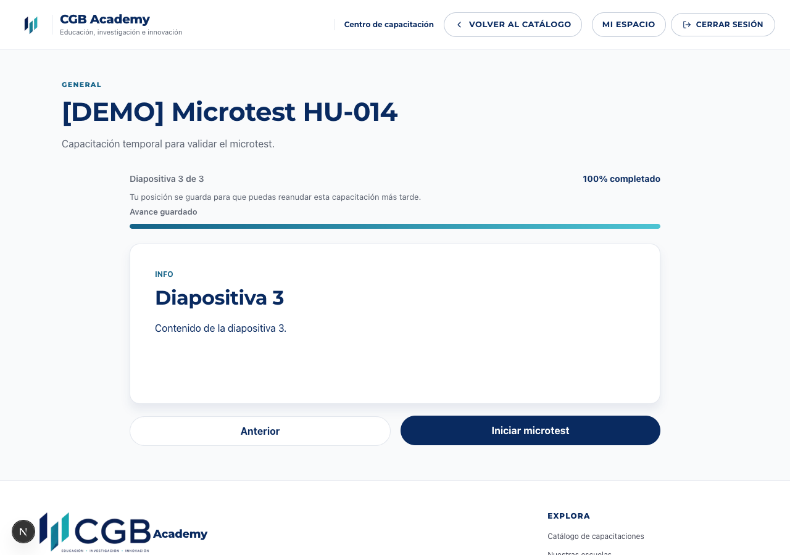

# HU-014 — Realizar microtest formativo interactivo (CGB-66)

Rama: `feature/CGB-66-realizar-microtest`, al día con `main` (18 de noviembre de 2026), que ya incluye HU-012 (CGB-56) y HU-013 (CGB-61). Esta HU no modifica `prisma/schema.prisma`: usa los modelos `Evaluacion` e `IntentoEvaluacion` de CGB-61, que ya tienen `onDelete: Restrict` e índice único `(usuario, evaluación, número)`.

## Historia

Como colaborador, quiero resolver el microtest al finalizar las diapositivas, para validar mi aprendizaje y obtener la aprobación del módulo.

## Criterios de aceptación y evidencia

| CA | Evidencia |
|---|---|
| CA-01 Interfaz interactiva | `tests/microtest-ui.test.mjs`: preguntas de opción múltiple, envío bloqueado hasta responder todas, temporizador opcional, y «Iniciar microtest» en el último slide. API: no se puede evaluar sin concluir las diapositivas (409). |
| CA-02 Calificación e informe | `tests/microtest.test.mjs` (`CA-02`, 2 pruebas): puntaje, aciertos, respuesta correcta y retroalimentación por pregunta. UI: informe de resultados. |
| CA-03 Aprobación y nota | `CA-03` (2 pruebas): con la nota mínima (o más) el intento queda `aprobado`, se guarda el puntaje y el avance pasa a `COMPLETADA`. |
| CA-04 Intentos y reintento | `CA-04` (3 pruebas): quedan intentos → «Revisar el material» y «Reintentar»; agotados o ya aprobado → 409. |

Pruebas adicionales: sesión obligatoria, origen válido y usuario solo de la sesión; validación de respuestas; error genérico ante fallos; envíos simultáneos sin superar el límite (`@@unique([usuarioId, evaluacionId, numero])`); `Finalizar` de HU-012 no completa una capacitación que tiene microtest.

## Evidencia en navegador (17 de noviembre de 2026)

Capacitación temporal `[DEMO] Microtest HU-014` en MongoDB Atlas, con la cuenta de colaborador de pruebas y `npm run dev`.

| CA | Captura |
|---|---|
| CA-01 |  |
| CA-01 |  |
| CA-02, CA-04 |  |
| CA-04 |  |
| CA-02, CA-03 |  |
| CA-03 |  |
| CA-04 |  |

## Diseño por capas

| Capa | Módulo |
|---|---|
| Presentación | `MicrotestInterno.tsx`, `VisorCapacitacionInterna.tsx`, `SlideViewer.tsx`, página `colaborador/capacitaciones/[id]` |
| Controlador | `src/lib/controlador-evaluacion.ts` (sesión, cuerpo, errores → HTTP); la ruta `src/app/api/evaluaciones/evaluar/route.ts` solo lo exporta |
| Lógica | `src/lib/servicio-evaluacion.ts` (sin HTTP: devuelve datos o lanza `ErrorMicrotest`/`ErrorProgreso`; `obtenerMicrotest` alimenta la página sin exponer respuestas) y `src/lib/microtest.ts` (reglas puras) |
| Datos | `src/lib/repositorio-evaluacion.ts` (solo `Evaluacion` e `IntentoEvaluacion`) |

**Dueño de los datos.** El avance (`ProgresoCapacitacion`) es de CGB-56. El microtest no lo escribe: `servicio-evaluacion` llama a `exigirListoParaMicrotest` y `completarPorMicrotest` de `servicio-progreso`, que usan su misma escritura optimista. En sentido contrario, `servicio-progreso` no conoce las evaluaciones: el controlador del avance pregunta `tieneMicrotest` y se lo indica con `exigeMicrotest`. Dos pruebas de `tests/microtest.test.mjs` vigilan estas fronteras.

**Consistencia entre colecciones.** Crear el intento y completar el avance no van en una transacción (MongoDB sin conjunto de réplicas garantizado). Si el cierre se interrumpe, el siguiente envío ve el intento aprobado, completa el avance y responde 409 «Ya aprobaste»; el intento aprobado no se pierde.

Las respuestas correctas no se envían al navegador antes de calificar (`preguntasParaResolver`).

## Trazabilidad

La historia de la rama se compactará al integrar (Squash). El código y las pruebas de la HU están en:

| Tarea Jira | Ítems de configuración |
|---|---|
| T1 RED | `tests/microtest.test.mjs` |
| T2 GREEN (API) | `src/lib/microtest.ts`, `servicio-evaluacion.ts`, `controlador-evaluacion.ts`, `repositorio-evaluacion.ts`, ruta `/api/evaluaciones/evaluar`, `completarPorMicrotest` y `exigeMicrotest` en `servicio-progreso.ts` |
| T2/T3 (interfaz) | `MicrotestInterno.tsx`, `SlideViewer.tsx`, `VisorCapacitacionInterna.tsx`, página del colaborador, `globals.css`, `tests/microtest-ui.test.mjs` |
| T4 VALIDACIÓN | este documento y `docs/evidencias-hu014/` |

Los commits siguen `tipo(CGB-66): descripción`. Jira: CGB-66 con vínculos *Blocks* con CGB-56 y CGB-61.

## Decisiones y límites

- El endpoint sigue lo indicado en Jira: `POST /api/evaluaciones/evaluar`.
- El temporizador es de la interfaz: al llegar a cero envía lo respondido. El servidor no valida la duración.
- Quién crea las evaluaciones y define sus modelos es HU-013 (CGB-61, ya en `main`). Aquí solo se resuelven.
- Pendiente de decisión del Product Owner: hoy el resultado muestra la respuesta correcta aun con intentos disponibles. Propuesta: mostrarla solo al aprobar o al agotar los intentos, y mientras tanto solo la retroalimentación. También decidir si el temporizador solo de interfaz es suficiente o si se registra el inicio del intento.
- La interfaz de revisión «revisar el material» vuelve al primer slide.

## Verificación (18 de noviembre de 2026)

- Con `main` hasta `3c6200c`: `npm test` 156 pasan y 0 fallan (incluye 22 de HU-014 y 2 de arquitectura), `npx tsc --noEmit`, `npx eslint src tests` y `next build` sin errores.

## Pendiente

- Los modelos de la HU los creó CGB-61; su `prisma db push` queda registrado en el PR #17. Esta HU no cambia el esquema. El flujo completo (reprobar, reintentar, agotar intentos, aprobar y reanudar) se probó en navegador contra Atlas el 18 de noviembre de 2026 con el código ya refactorizado; las capturas están en `docs/evidencias-hu014/`. Los datos `[DEMO]` creados para la prueba se borraron al terminar.
- No hay E2E automatizado (T4 de Jira).
- Revisión por pares y aprobación del PR #13; DoD del equipo (PR #12, ya en `main`).
