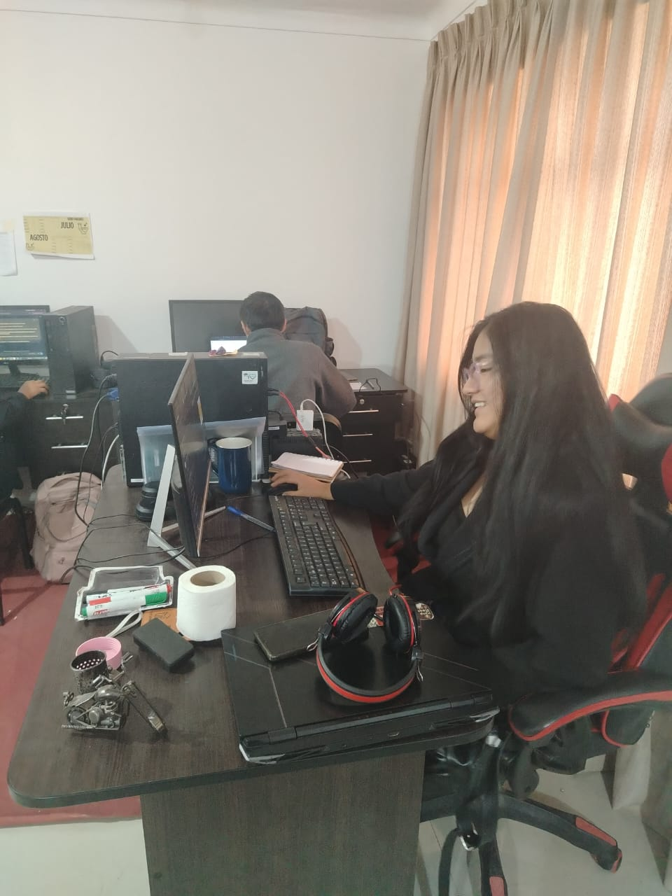
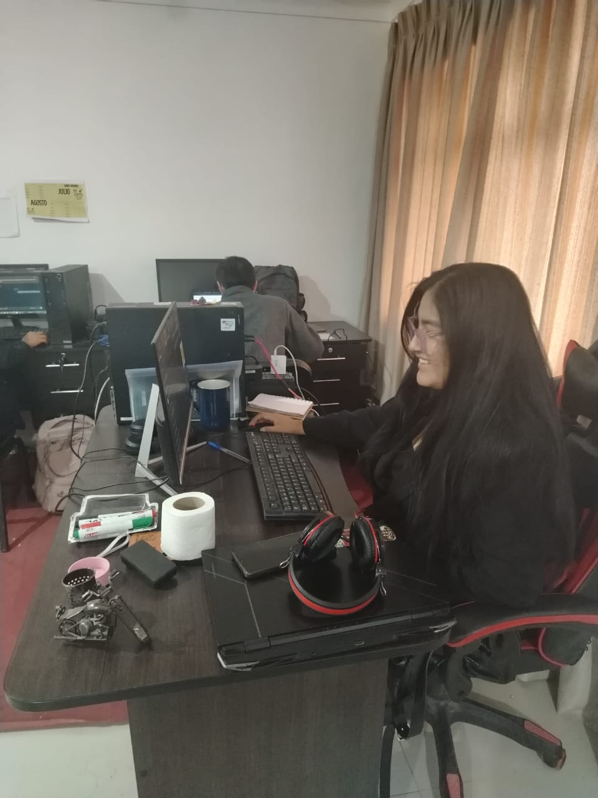
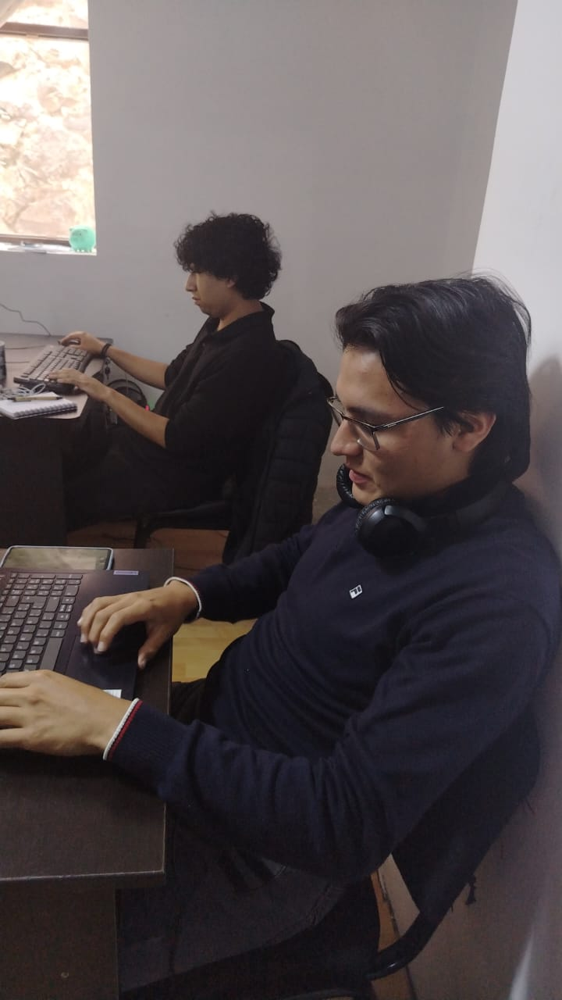
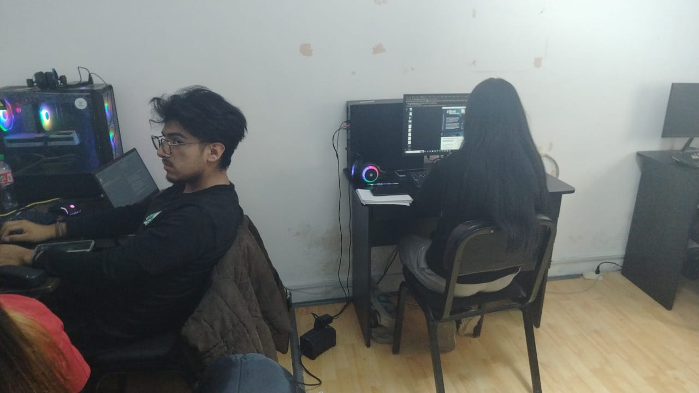

# Informe breve: identificación y validación de necesidades

**Proyecto:** CGB Academy · **Curso:** Ingeniería de Software I · **Corte:** 21/10/2026
**Alcance del producto:** CGB Academy cubre dos recorridos: capacitación privada de empleados (inducción por área/puesto, avance y microtests) y orientación pública para estudiantes y docentes (guías para usar plataformas y resolver casos de CIIP LATAM, GEOMINA LATAM y BIOMEDIC). Administración de contenidos organiza ambos recorridos; TI apoya su operación segura.

**Estado de evidencia:** el equipo confirma que la captura de requerimientos y los conversatorios ya se realizaron con administración de ventas, TI, operaciones académicas y otros participantes. Las cuatro fotografías se incorporan como evidencia visual contextual; no se asigna cada imagen a un rol.

Base consultada: captura de requerimientos consolidada reportada por el equipo, [especificación funcional y no funcional](../CGB_Academy_Requerimientos_Funcionales_y_No_Funcionales.pdf), alcance del MVP, Jira y código vigente. La venta de cursos, pagos y seguimiento comercial no se confunden con la función formativa del producto. El registro de fuentes y los límites de la evidencia están en [`registro_conversatorios.md`](registro_conversatorios.md).

## A. Stakeholders y persona

| Stakeholder / relación con el producto | Expectativa documentada o por validar | Poder | Interés | Prioridad |
|---|---|---:|---:|---|
| Operaciones académicas (área entrevistada; administración de contenido) | Crear/publicar guías públicas y gestionar capacitación y rutas internas | Alto | Alto | Alta; gestionar de cerca |
| TI (área entrevistada; soporte técnico) | Separar acceso público e interno y proteger sesiones, datos e infraestructura | Alto | Alto | Alta; gestionar de cerca |
| Administración de ventas (área entrevistada) | Aportar procesos, plataformas y casos de uso que la capacitación debe explicar | Medio | Alto | Alta para consulta |
| Colaborador/empleado (usuario interno) | Completar la ruta de inducción de su área o puesto y retomar su avance | Medio | Alto | Alta |
| Estudiantes y docentes (usuarios públicos) | Encontrar guías prácticas para plataformas y casos sin crear una cuenta | Bajo | Alto | Alta; mantener informados |
| Product Owner/directorio | Definir alcance, prioridad y contenidos aprobados | Alto | Alto | Alta; gestionar de cerca |

La matriz distingue áreas consultadas de actores que usan el sistema: el empleado consume formación interna; estudiantes/docentes consultan guías públicas; el Administrador gestiona contenidos y rutas. Poder/interés son estimaciones justificadas por responsabilidad, no citas. **Arquetipo real anonimizado — participante de Operaciones Académicas:** su relación funcional con el rol Administrador/gestor de contenido es una asociación propuesta, sujeta a los permisos que defina el PO. Su objetivo es organizar rutas internas por área/puesto y publicar guías sobre plataformas y casos de CIIP LATAM, GEOMINA LATAM y BIOMEDIC. Necesita que cada público encuentre su material y que el avance de empleados sea privado. La síntesis usa la captura y la especificación; citas y atributos personales solo se incorporan si constan allí. Las fotos no se asignan a una persona o rol.

La matriz poder–interés es provisional: alto/alto se gestiona de cerca; bajo/alto se mantiene informado. Las fotos aportan evidencia contextual de las sesiones, no de las respuestas ni de la asignación de cada participante a una imagen.

**Elicitación y técnica complementaria:** la captura y los conversatorios ya se realizaron con las áreas indicadas y otros participantes. Se revisaron la especificación, las historias del backlog y el alcance del producto. Preguntas para operaciones académicas: (1) ¿Qué plataformas y casos necesitan guías públicas para estudiantes/docentes? (2) ¿Qué pasos y recursos deben incluir esas guías? (3) ¿Qué temas y rutas necesita el personal según su área o puesto? (4) ¿Cómo se publica y actualiza el material para ambos públicos? (5) ¿Quién debe ver el avance interno y qué debe quedar privado? Las preguntas son el guion de la actividad, no citas de respuestas.

## B. Requisitos revisados

| Tipo y requisito inicial | Problema | Reformulación y verificación |
|---|---|---|
| **Funcional — RF-005/RF-006 (público):** explorar y consultar capacitaciones públicas. | No precisa que las guías deben orientar sobre plataformas y casos ni cómo distinguir su público objetivo. | El catálogo ofrece solo material PUBLICADO/PÚBLICO; la ficha y guía muestran unidad (CIIP LATAM, GEOMINA LATAM o BIOMEDIC), categoría/audiencia y propósito (plataforma/caso) cuando se configure. **Verificar:** acceso anónimo, clasificación visible, enlaces y rechazo de material interno. |
| **Funcional — RF-011/RF-012 (empleados):** panel y avance de onboarding “en tiempo real”. | “Tiempo real”, estado y alcance de lo que cuenta como avance no están definidos. | Para N capacitaciones asignadas y M completadas, el panel muestra la ruta del área/puesto y estados; calcula `round(100×M/N)` (0% si N=0) usando solo avance interno guardado. **Verificar:** ruta vacía/mixta, reanudación y aislamiento por cuenta. |
| **No funcional — RNF-004:** contenido ligero y carga `<1,5 s` en 4G. | No fija las vistas, dispositivo ni medición. | En producción, catálogo público y primera guía tendrán LCP p95 `<1,5 s` en 20 mediciones, con perfil 4G, dispositivo y dataset acordados. **Verificar:** registrar parámetros y medidas; PO confirma umbral. |
| **Regla de negocio — visibilidad:** contenido público/interno. | No explicita el acceso de visitante ni el efecto del consumo público en el onboarding. | Solo una capacitación PUBLICADA/PÚBLICO se sirve a visitantes; el contenido INTERNO exige sesión. Consultar una guía pública no crea ni modifica avance de empleado. **Verificar:** pruebas anónimas de API/URL y comprobar progreso interno antes/después. |
| **Restricción — alcance MVP:** no es tienda ni LMS académico; certificados y videos pesados excluidos. | Una orientación pública puede confundirse con venta de cursos o aula virtual. | El MVP brinda guías/capacitaciones autoguiadas de uso de plataformas y procesos; no incluye carrito, pagos, clases en vivo, streaming ni certificados. **Verificar:** inspeccionar historias, navegación y APIs del producto. |

## C. Backlog refinado y trazabilidad

- [**CGB-26 · HU-006: Consultar una capacitación pública**](https://cgb-academy.atlassian.net/browse/CGB-26), historia priorizada para el recorrido público de estudiantes/docentes (catálogo relacionado: [CGB-21 · HU-005](https://cgb-academy.atlassian.net/browse/CGB-21)). Como estudiante o docente, quiero seguir una guía pública sobre una plataforma o caso de CIIP LATAM, GEOMINA LATAM o BIOMEDIC, para completar la tarea de forma autónoma sin crear una cuenta. Necesidad NP: encontrar orientación práctica para esas unidades; trazada a RF-005/RF-006 y a la captura reportada por el equipo. Aceptación: solo contenido público/publicado; unidad, categoría y propósito visibles; enlaces/acciones funcionales; consulta anónima sin alterar el progreso interno. Tareas: CGB-27 pruebas, CGB-28 implementación, CGB-29 refactor y CGB-30 validación/PR. Jira está en Revisión con prioridad Medium; la especificación asigna Alta a HU-006, por lo que el PO debe resolver la discrepancia.
- [**CGB-56 · HU-012: Completar capacitación interna y registrar avance**](https://cgb-academy.atlassian.net/browse/CGB-56), prioridad **Highest** (Crítica en la especificación). Como empleado, quiero guardar y retomar el último slide confirmado de mi ruta, para continuar la inducción sin perder lo avanzado. Necesidad NE: conocer el estado y continuar formación interna por área/puesto; trazada a RF-012 y a la captura reportada por el equipo. Aceptación: guardar y reanudar; completar solo al confirmar el último slide; aislar avances por cuenta; una guía pública no altera este progreso; una confirmación repetida no duplica avance. Tareas: CGB-57 pruebas, CGB-58 endpoint/persistencia, CGB-59 idempotencia/UX y CGB-60 BDD/PR. CGB-51/HU-011 completa el panel y la ruta personal.

**Nota Jira (revisado el 21/10):** CGB-26 está en Revisión, prioridad Medium; CGB-56 y su dependencia CGB-51 están en Tareas por hacer, prioridad Highest. Las prioridades/estados no se alteran en este informe. CGB-26 difiere de la prioridad Alta de HU-006 en la especificación: el PO debe resolverlo. Las historias refinadas deben enlazar la captura por RF-005/RF-006 y RF-012; los conversatorios sí se realizaron, según el equipo. CGB usa el tipo “Tarea” para historias de usuario.

## Reflexión y pendientes

Habíamos descrito el producto casi solo desde la inducción del empleado y dejamos poco visible el recorrido público para estudiantes y docentes. El siguiente sprint debe hacer identificables en el catálogo las guías por unidad, audiencia y caso de uso, sin mezclar el progreso público con el onboarding privado. En paralelo, el empleado necesita guardar y retomar su avance. Ventas aporta contexto de negocio, pero el seguimiento de prospectos, pagos y venta de cursos sigue fuera del MVP. El PO debe resolver la prioridad de CGB-26 y confirmar el umbral de rendimiento y la regla de visibilidad.

## Evidencia fotográfica

Las cuatro imágenes se incluyen en el proyecto LaTeX como evidencia visual de los conversatorios. Se presentan sin nombres ni asignación de una fotografía a una persona o rol específico.

